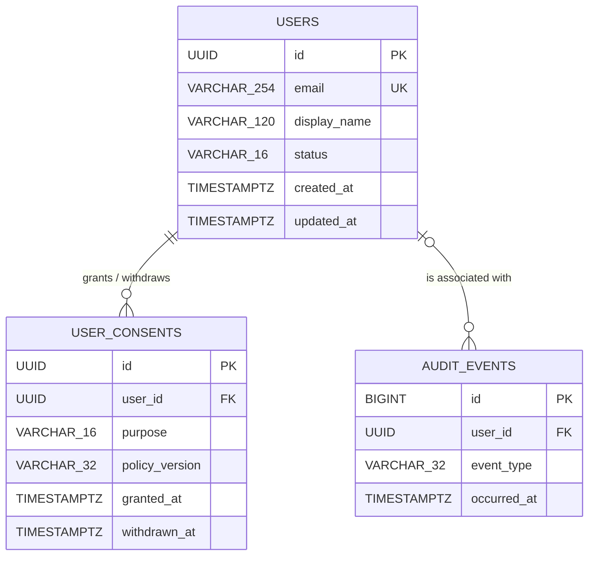

# Database design: conceptual, logical and physical models

The example illustrates a **relational PostgreSQL 17** data model. It is intentionally
minimal and privacy-aware, not a fully fledged identity/authorization service.

## Conceptual (entity–relationship) model

A user has zero or more consent **history entries**; each entry belongs to exactly
one user. A user may have zero or more audit events. An audit event may be
disassociated from its user when that user is erased (ON DELETE SET NULL).

## Logical relational model

- **USERS**(**id**, email UNIQUE, display_name, status, created_at, updated_at)
- **USER_CONSENTS**(**id**, user_id FK → USERS.id, purpose, policy_version,
  granted_at, withdrawn_at)
- **AUDIT_EVENTS**(**id**, user_id FK → USERS.id NULLABLE, event_type, occurred_at)
- **SCHEMA_MIGRATIONS**(**version**, checksum, applied_at): deployment metadata,
  created by the migration runner.

Candidate keys: USERS.id, USERS.email; USER_CONSENTS.id, AUDIT_EVENTS.id.
The active (withdrawn_at IS NULL) consent pair (user_id, purpose) is unique
using a partial unique index; history rows may repeat the pair.

Non-key attributes depend on their table's key. There are no
transitive dependencies between business attributes (3NF). A single mutable
`consent` boolean would lose essential consent history, so history is a
separate entity.

## Physical model and constraints

See [sql/001_init.sql](../sql/001_init.sql). UUIDs are generated in the DB;
TIMESTAMPTZ stores time-zone-aware instants; the user status/purpose/event types
use CHECK constraints. E-mails are trimmed/lowercased in the application, and
the DB checks canonical casing; a UNIQUE constraint prevents duplicates.
Referential integrity, partial indexes, and transactional writes prevent
orphaned or concurrently duplicated active consents.

**Privacy:** consent is optional and purpose-specific (marketing/analytics).
It is never assumed merely from account creation. Withdrawal keeps a history
row but marks it inactive. Deleting a user cascades to their consent history;
audit entries retain an event type and time and lose their user link after deletion; before deletion, the pseudonymous user_id remains personal data under data-protection law.
A real deployment still needs a legal basis, retention policy, privacy notice,
backup erasure/retention procedures, and access controls.

## Migration policy

`scripts/migrate.ts` creates `schema_migrations` and applies ordered SQL files
atomically under a transaction-level advisory lock. Applied migration contents
are SHA-256 checked to detect accidental modifications. **Never edit an
already-applied migration**: add `002_...` instead. Test migrations on a
nonproduction database before deploying. Back up databases before changes.

## Segunda migración: crecimiento y consultas

`sql/002_pagination_indexes.sql` crea los índices `(status, created_at DESC, id)`
para búsquedas por estado y `(user_id, granted_at DESC, id DESC)` para el
historial paginado de consentimientos. Añade la restricción
`updated_at >= created_at`. La paginación con desplazamiento se ha limitado
para evitar consultas sin cota; si se esperan millones de filas, conviene
migrar a paginación por cursor y estudiar los planes con `EXPLAIN ANALYZE`.
